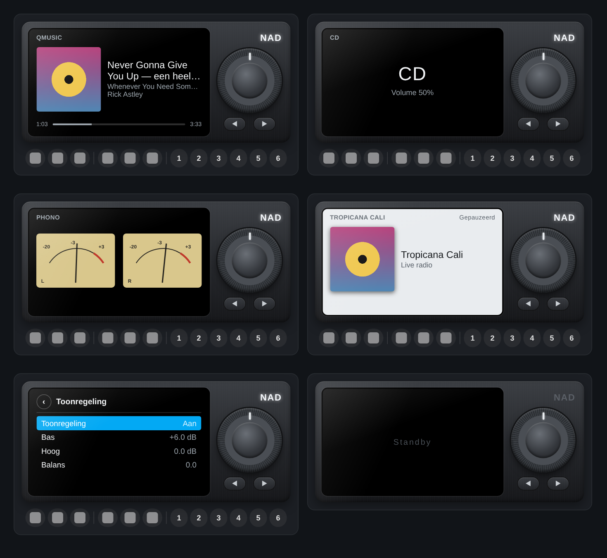

# NAD C 700 Card

A Lovelace card for Home Assistant that recreates the front panel of the **NAD C 700 / C 700 V2** BluOS streaming amplifier: the 5" display, the VOLUME-MENU knob, the two arrow keys, the NAD status logo, the on-device menu and an optional BC1-style remote bar.



## Features

- **Display** with the C 700 screen modes: album art + text (now playing with progress), art only, simple source view (big source name + volume) and animated retro VU meters. Pick a mode per source. Dark or light background follows the amplifier's *Dark mode* setting.
- **VOLUME-MENU knob** that behaves like the real one:
  - tap the **centre** = press (play/pause, or select/save in the menu)
  - hold the **centre** = press and hold (open/close the menu)
  - tap the **left/right** side = turn one step (volume, or move through the menu)
  - hold the **left/right** side = keep turning (or open the menu, configurable)
  - mouse wheel and keyboard arrows also turn the knob
- **Volume overlay** on the display while turning, in % or (approximate) dB between your volume limits.
- **Menu** as on the amplifier: Sources, Presets, Playback (shuffle/repeat) and Settings: sleep timer, tone controls (bass, treble, balance), subwoofer, display (auto brightness, brightness, dark mode, indicator), Bluetooth mode, volume limits, Replay Gain and output mode. Change a value with the knob or arrows and press to save; rows can also be tapped.
- **Power button**: wakes the amplifier from network standby by resuming the last track (like pressing play in the BluOS app), with an optional fallback preset or input if nothing starts within 5 seconds. Switching off stops playback; the C 700 then goes to standby by itself after 15 minutes (*Amplifier Standby*).
- **NAD logo** acts as the status indicator and follows the *Indicator brightness* setting.
- **BC1 remote bar**: power, mute, volume, previous/play-pause/next and preset buttons.
- Optional **knob lock** for wall tablets (hold to unlock for 30 s).
- **Visual editor**: configure everything from the dashboard UI.
- Dutch and English labels.

## Requirements

- [Bluesound Alt](https://github.com/aunefyren/bluesound_alt) integration (player and amplifier settings).
- Optional: the core [Bluesound](https://www.home-assistant.io/integrations/bluesound/) integration, used for your BluOS presets.

Entities are discovered automatically from the amplifier's device.

## Installation

[](https://my.home-assistant.io/redirect/marketplace_repository/?owner=nosehook&repository=nad-c700-card&category=plugin)

<!-- ha-marketplace:exclude-start -->
### HACS / Marketplace (custom repository)
1. Add `https://github.com/nosehook/nad-c700-card` as a custom repository, category **Dashboard**.
2. Install **NAD C 700 Card** and reload your browser.

### Manual
1. Copy `nad-c700-card.js` to `/config/www/`.
2. Settings → Dashboards → ⋮ → Resources → add `/local/nad-c700-card.js` as a **JavaScript module**.
<!-- ha-marketplace:exclude-end -->

## Configuration

Add the card from the card picker and use the visual editor, or in YAML:

```yaml
type: custom:nad-c700-card
```

| Option | Default | Description |
|---|---|---|
| `name` | `NAD C 700` | Card name |
| `entity` | auto | Bluesound Alt media player |
| `presets_entity` | auto | Core Bluesound media player (for presets) |
| `default_view` | `auto` | `auto`, `art_text`, `art`, `source` or `vu` |
| `view_cd`, `view_phono`, `view_line_in`, `view_optical_input`, `view_hdmi_earc`, `view_bluetooth` | `auto` | Display mode per source |
| `dark_mode` | `follow` | `follow` (amplifier setting), `always` or `never` |
| `step` | `2` | Volume step per click, in % |
| `volume_unit` | `percent` | `percent` or `db` (approximate, between your volume limits) |
| `hold_sides` | `repeat` | Holding left/right: `repeat` (keep turning) or `menu` |
| `knob_lock` | `false` | Lock the knob; hold it to unlock for 30 s |
| `hide_menu` | `[]` | Menu items to hide: `sources`, `presets`, `playback`, `sleep`, `tone`, `subwoofer`, `display`, `bluetooth`, `limits`, `replay`, `output` |
| `menu_timeout` | `30` | Seconds before the menu closes |
| `wake_fallback` | – | Preset or input to start when the last track does not resume (e.g. `Qmusic`, `CD`) |
| `confirm_off` | `true` | Tap the power button twice to stop playback |
| `show_remote` | `true` | Show the BC1 remote bar |
| `remote_presets` | `5` | Number of preset buttons on the remote bar |
| `language` | `nl` | `nl` or `en` |

### Notes

- There is no direct standby command: the power button wakes the amplifier with *play* and switches it off by stopping playback, after which it enters standby by itself.
- The VU meters are an animation; BluOS does not report audio levels.

## License

MIT
